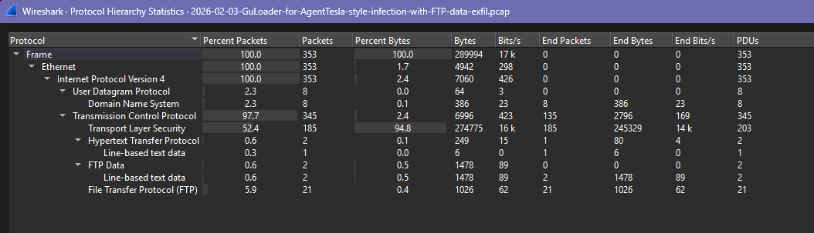
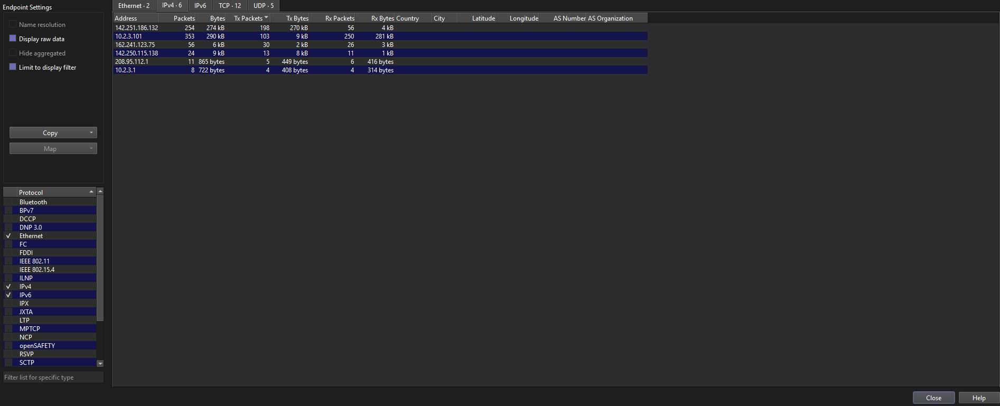
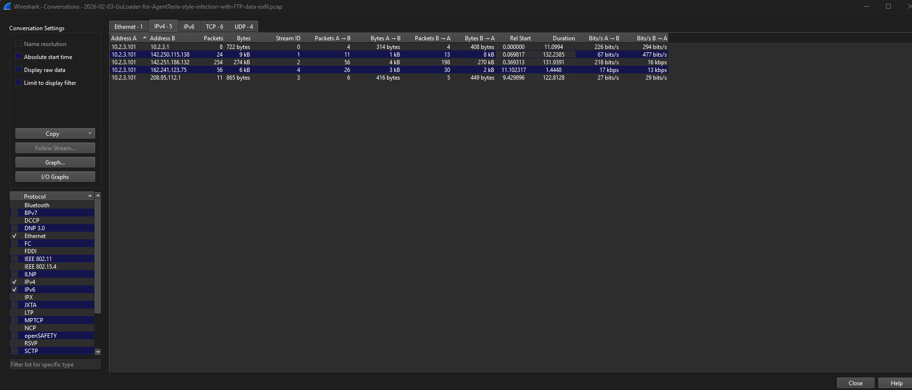
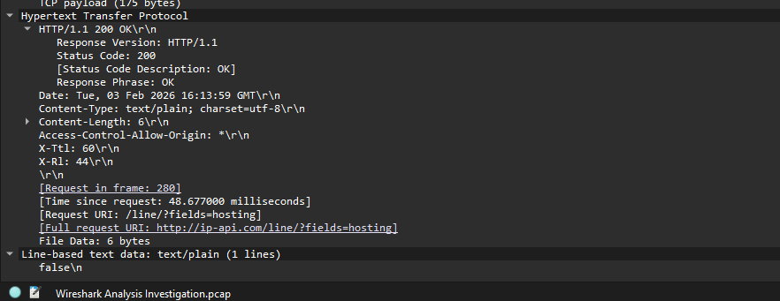
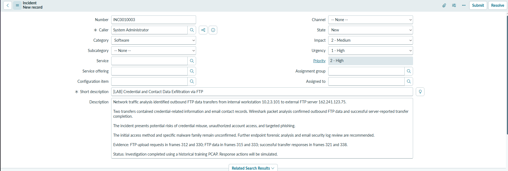
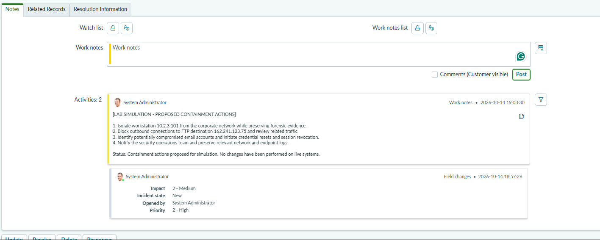
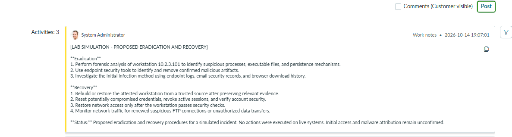
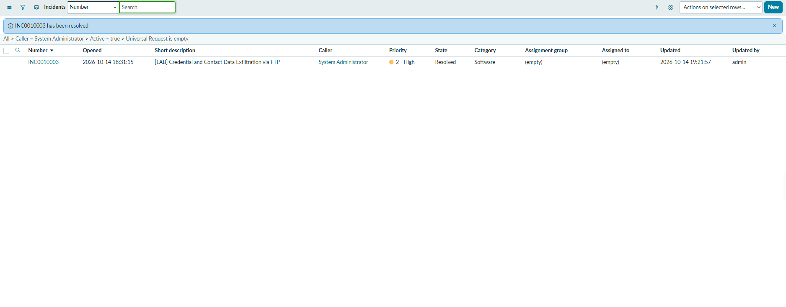
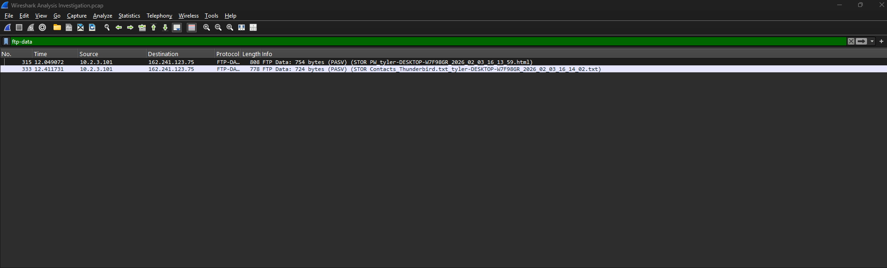

# FTP Data Exfiltration Investigation | Wireshark + ServiceNow

**Network forensics · SOC investigation · Simulated incident response**  
**Tools:** Wireshark, ServiceNow ITSM Incident Management | **Lab incident:** `INC0010003`

## At a glance

- **Finding:** Workstation `10.2.3.101` uploaded two files containing credential-related records and an email contact list to external FTP server `162.241.123.75`.
- **Evidence:** FTP `STOR` requests, outbound `FTP-DATA` packets (frames **315** and **333**), readable TCP streams, and server `226` completion replies support the two uploads.
- **Response:** Documented the evidence and proposed containment, eradication, and recovery in ServiceNow incident `INC0010003`. Actions were **simulated**, not executed against a live environment.

> **Scope:** The [public training scenario](https://www.malware-traffic-analysis.net/2026/index.html) was labeled as *GuLoader for AgentTesla-style infection with FTP data exfiltration*. That title supplied an investigative lead; I verified the FTP transfers from packet evidence. Neither the exact malware family nor the initial-access method was independently proven. This project used **ServiceNow ITSM Incident Management**, not the dedicated Security Incident Response (SIR) application.

## Business problem

A security team needs to convert network evidence into a prioritized, traceable incident with clear response actions and documented uncertainty.

## Investigation method (reproducible)

I began with **Statistics → Protocol Hierarchy**, **Endpoints → IPv4**, and **Conversations → IPv4** to establish the protocols, hosts, and data directions before inspecting individual sessions.

| Wireshark filter or feature | What I used it for |
|---|---|
| `ftp` | Review FTP login, `PASV`, `STOR`, and server status replies |
| `ftp-data` | Locate transferred file data rather than just FTP commands |
| `ip.addr == 10.2.3.101 && ip.addr == 142.251.186.132` | Isolate the large workstation-to-public-IP TLS conversation |
| `frame.number < 289` | Inspect packets captured before the FTP session |
| `frame.number == 282` | Read the HTTP response to the `ip-api.com` query |
| `frame.number == 28` | Inspect the TLS Client Hello and SNI |
| **Follow → TCP Stream** | Reconstruct FTP file data and examine the encrypted TLS exchange |

**Additional useful filter, not required in my original walkthrough:** `ftp.request.command == "STOR"` isolates FTP upload requests. To reproduce the upload analysis, compare the matching commands with `ftp-data` traffic and the corresponding `226` responses. `STOR` alone shows a requested upload, not successful delivery.

### Network overview

The capture contains **353 packets**, **6 IPv4 endpoints**, and **5 IPv4 conversations**. The private workstation `10.2.3.101` participates in all five conversations.

The largest conversation was encrypted TLS traffic from `142.251.186.132` toward the workstation (approximately 270 KB). Its volume was notable but **did not establish a malware download**.

## Evidence and findings

| Frames | Observation | Conclusion / limitation |
|---|---|---|
| 23–28 | DNS lookup for `drive.usercontent.google.com`, resolution to `142.251.186.132`, TCP setup, and TLS Client Hello with matching SNI | Connected to the requested content-service hostname; encrypted content could not be verified |
| 280, 282 | HTTP GET `/line/?fields=hosting` to `ip-api.com`; response `200 OK`, body `false` | Hosting-classification lookup observed; purpose and responsible process unknown |
| 290–295 | FTP `USER`/`PASS` and server `230` response | FTP login reported successful; values not reproduced here |
| 312–321 | First `STOR`, server `150`, FTP-DATA in **315** (754 bytes), server `226` | Outbound file data transferred; server reported successful completion |
| 330–338 | Second `STOR`, server `150`, FTP-DATA in **333** (724 bytes), server `226` | Second outbound upload; server reported successful completion |

**Exfiltration direction:** `10.2.3.101` (FTP client) → `162.241.123.75` (external FTP server). FTP control and data contents in this capture were readable **without TLS decryption**. Password-labeled fields were visible in the captured packet contents, and the second transferred file contained readable email addresses. The uploaded records included password-labeled fields and email contacts; the cryptographic state or usability of each individual password value was **not** established. This separates plaintext **transport** from whether a stored credential value may itself be encoded or protected.

**Screenshot privacy review:** The FTP-DATA screenshot was withheld from inline display because its filename metadata contained a local username. See frames 315 and 333 in the evidence table; an appropriately redacted screenshot can be added later.

### Activity preceding the FTP uploads

The `ip-api.com` lookup could be consistent with an environment check, but this remains a **hypothesis**; the PCAP does not link the lookup and later FTP transfers to the same executable.

### Timeline (capture order)

| Order | Event | Frames |
|---|---|---|
| 1 | Google-related domain resolution and encrypted TLS connection | 23–28 onward |
| 2 | HTTP hosting-information lookup | 280–282 |
| 3 | FTP hostname resolution and session establishment | 284–289 |
| 4 | FTP authentication | 290–295 |
| 5 | First outbound upload | 312–321 |
| 6 | Second outbound upload | 330–338 |

Capture-relative timestamps do not directly measure file transfer duration. The timeline alone does not prove a causal infection chain.

## Indicators and detection opportunities

These are **case-specific indicators and investigation leads**, not a universal blocklist.

| Indicator | Role | Confidence / caution |
|---|---|---|
| `10.2.3.101` | Internal workstation involved in both FTP uploads | Confirmed in capture; not a globally malicious IP |
| `162.241.123.75` | External FTP upload destination | Confirmed destination in this lab; validate before any real-world blocking |
| `ftp.corwineagles.com` | DNS name associated with FTP destination | Observed in DNS; recheck current ownership before operational use |
| `drive.usercontent.google.com` / `142.251.186.132` | Google-related TLS connection | Contextual lead, **not** confirmed malicious infrastructure |
| `ip-api.com` | Hosting-field information query | Legitimate service; **not** a malicious IOC by itself |

**Proposed detection ideas (not implemented):**

1. **Unexpected outbound FTP:** Alert when employee workstations connect to external FTP servers, especially previously unseen destinations. Requires network connection or firewall telemetry.
2. **FTP upload behavior:** Alert on `STOR` commands to non-approved destinations, correlating command, data-channel bytes, and `226` success where packet inspection is available. Plain FTP control traffic is inspectable; FTPS would require different visibility.
3. **Credential-access-to-egress sequence:** Correlate unusual access to credential stores or contact files with outbound file transfers from the same process or host. Requires endpoint/EDR telemetry and network logs; it **cannot be established from this PCAP alone**.

**MITRE ATT&CK:** Behavior is **consistent with [T1048.003 — Exfiltration Over Unencrypted Non-C2 Protocol](https://attack.mitre.org/techniques/T1048/003/)**, which includes FTP. This is a behavioral mapping, not a verified malware-family attribution or proof of a distinct C2 channel.

## ServiceNow: simulated incident response

I created lab incident **`INC0010003`** in the standard ITSM Incident application to document the analysis and a proposed response workflow.

| Field | Value / rationale |
|---|---|
| Category | **Software** — closest available practical category in the lab; not a security-specific SIR classification |
| Impact | **2 – Medium** — one observed workstation and unknown wider exposure; number and privilege level of affected accounts were not verified |
| Urgency | **1 – High** — credential-related exposure warranted prompt protection of potentially affected accounts |
| Priority | **2 – High** — automatically calculated by this ServiceNow instance |
| Assignment group | Unassigned — no appropriate SOC group selected in the lab |
| Final status | **Resolved as a training exercise only**, not proof of real-world remediation |

**Containment plan (not performed):** preserve evidence, isolate the workstation through authorized procedures, restrict FTP egress to the destination, identify exposed accounts, reset credentials, and revoke active sessions where appropriate.

**Eradication and recovery plan (not performed):** request endpoint and email logs, identify suspicious processes/persistence, remove confirmed malicious artifacts, restore from trusted sources as appropriate, and monitor for recurrence.

The ITSM ticket was marked **Resolved** to close the *lab exercise*. No live host was isolated, disinfected, or verified recovered.

## Outcome and limitations

The investigation verified **two outbound FTP uploads** containing credential-related records and email contacts, then carried that evidence into a prioritized ServiceNow ITSM record with proposed response work notes. It did **not** prove GuLoader/AgentTesla execution, a specific initial-access technique, which process initiated the traffic, or successful real-world remediation. Endpoint process logs, EDR alerts, browser/download artifacts, and email security logs would be needed to investigate those questions.

**Key lesson:** A client `STOR` command alone isn't proof of exfiltration; inspect the outbound data connection and `226` reply. High-volume TLS traffic also isn't automatically malicious.

## Dataset provenance and safe sharing

- **Source:** [Malware-Traffic-Analysis.net — 2026 archive](https://www.malware-traffic-analysis.net/2026/index.html), February 3, 2026 GuLoader/AgentTesla-style scenario. Credit for the sample belongs to the original publisher.
- **PCAP filename:** `2026-02-03-GuLoader-for-AgentTesla-style-infection-with-FTP-data-exfil.pcap`
- **SHA-256 (analyzed file):** `2fa7e8b80d9f0b460b98ed053fbfc9710ff21a4b689b16acb58e0cdc13bf9769`
- **Sharing policy:** The PCAP, captured login values, password-bearing streams, and full email contact list are excluded from this public repository. Only relevant, sanitized screenshots are included.

The hash identifies the specific file analyzed; it does **not** establish the legitimacy of its contents.
y but still fail to document evidence, prioritize risk, and track response actions. This project demonstrates a repeatable handoff: inspect network evidence in Wireshark, create an incident with defensible findings, document proposed response actions, and record the lab's resolution in ServiceNow.

## Investigation approach

Instead of using the sample's malware label as proof, I worked from general traffic reconnaissance toward specific evidence:

1. Reviewed **Protocol Hierarchy** to identify observed protocols (TCP/TLS, DNS, HTTP, FTP).
2. Used **IPv4 Endpoints** and **Conversations** to identify participants and data direction.
3. Examined a large TLS exchange and checked DNS resolution plus Client Hello SNI.
4. Investigated FTP control messages (`USER`, `PASS`, `230`, `PASV`, `STOR`, `150`, `226`).
5. Examined `ftp-data` packets and TCP streams to verify transferred data types, without republishing their sensitive contents.
6. Reconstructed the limited chronology before FTP, including an HTTP IP-information lookup.
7. Opened and resolved a **simulated** ServiceNow ITSM incident, preserving internal work notes for proposed containment, eradication, and recovery.

### Traffic overview

The training capture contains **353 packets** across **6 IPv4 endpoints**. These are findings from this sample, not a baseline for normal network behavior.

The private host `10.2.3.101` participated in all 5 IPv4 conversations. A large TLS conversation with `142.251.186.132` sent approximately 270 KB *toward* the workstation, but traffic volume alone did not establish a malicious download.

## Verified network findings

| Evidence | Observation | Interpretation / limit |
|---|---|---|
| Frames 23–28 | DNS resolved `drive.usercontent.google.com` to `142.251.186.132`, followed by TCP and TLS handshake with matching SNI | Hostname and encrypted connection observed; content/initial access not established |
| Frames 280, 282 | HTTP GET to `ip-api.com/line/?fields=hosting`; response `200 OK`, body `false` | Hosting-status query observed; an environment-check motive is only a hypothesis |
| Frames 290–295 | FTP `USER`/`PASS` exchange and `230` login success | FTP authentication succeeded; captured credentials intentionally omitted |
| Frames 312, 314–315, 321 | First FTP `STOR` operation, associated server acceptance, 754-byte FTP-DATA payload, `226` completion | File data traveled from private host to external FTP server and server reported successful completion |
| Frames 330, 332–333, 338 | Second FTP `STOR` operation, associated server acceptance, 724-byte FTP-DATA payload, `226` completion | Second outbound upload with server-reported success |

**Exfiltration flow:** `10.2.3.101` (FTP client) → `162.241.123.75` (external FTP server). The uploaded data contained **credential-related records** and an **email contact list**. Individual password values were not independently classified as plaintext or cryptographically protected. Filenames alone were not used as proof; FTP-DATA and stream inspection provided stronger evidence.

### Secondary lead: IP-information lookup

The `false` response was returned for the `hosting` field. The capture does not prove which local process requested it or whether it was related to the subsequent uploads.

## Case timeline (capture order)

| Sequence | Event | Reference |
|---|---|---|
| 1 | Google-related DNS lookup and TLS session began | Frames 23–28 |
| 2 | IP-information lookup completed | Frames 280–282 |
| 3 | FTP name resolution and connection setup | Frames 284–289 |
| 4 | FTP login succeeded | Frames 290–295 |
| 5 | First outbound FTP upload | Frames 312–321 |
| 6 | Second outbound FTP upload | Frames 330–338 |

> Capture-relative timing is not the same as file-transfer duration. Chronology does not establish that separate network events were initiated by the same process.

## ServiceNow ITSM incident

A lab ticket was created in the **standard Incident Management** application using the available developer instance.

| Field | Value |
|---|---|
| Incident | `INC0010003` |
| Short description | `[LAB] Credential and Contact Data Exfiltration via FTP` |
| Category | Software |
| Impact | 2 – Medium |
| Urgency | 1 – High |
| Priority | 2 – High (calculated by instance) |
| Final state | Resolved **for training exercise only** |
| Assignment group | Unassigned (no appropriate group selected in lab) |

### Proposed response lifecycle

**Containment (proposed):** isolate the affected workstation after preserving evidence, restrict communication to the FTP destination, protect potentially exposed accounts, and notify responders.

**Eradication and recovery (proposed):** acquire and analyze endpoint evidence; remove confirmed malicious artifacts; examine possible initial access; rebuild from a trusted source where appropriate; reset exposed credentials; verify system health; monitor for renewed exfiltration.

**Training disposition:** The investigation and response *planning* were completed. No live endpoint was isolated, repaired, or verified clean. ServiceNow incident `INC0010003` was marked Resolved to conclude the lab workflow, not to certify real-world remediation.

## Business value

- Linked a technical finding to a searchable, prioritized incident record.
- Preserved the evidence chain and distinguished observations from hypotheses.
- Documented response ownership gaps, containment recommendations, and recovery prerequisites.
- Demonstrated how ITSM incident tracking can support a **simulated** SOC workflow, even without the dedicated SIR module.

## Limitations and next evidence requests

- TLS application data was not decrypted; no particular payload download was confirmed.
- The specific GuLoader/AgentTesla malware attribution remains unverified from this network-only investigation.
- Initial access and the identity of the responsible executable/process were not established.
- Endpoint/EDR records, Windows process execution logs, browser history, and email security logs would be needed to test infection hypotheses.
- The training case does **not** demonstrate actual containment or verified restoration.

## Lessons learned

The largest conversation is not automatically the malicious one. A command (`STOR`) shows an intended action; data packets and completion replies provide stronger evidence that an upload occurred. Carefully scoped conclusions and reproducible packet references are more valuable than naming a malware family without proof.

## Source and safe sharing

Training capture: [Malware-Traffic-Analysis.net](https://www.malware-traffic-analysis.net/2026/index.html) (February 3, 2026 scenario). Credit belongs to the original dataset publisher. **The PCAP is deliberately excluded** because it includes credential-related fields and a contact list. Screenshots showing plaintext credentials or contact addresses are deliberately excluded. Never publish live secrets, full email contact lists, or captured passwords.
